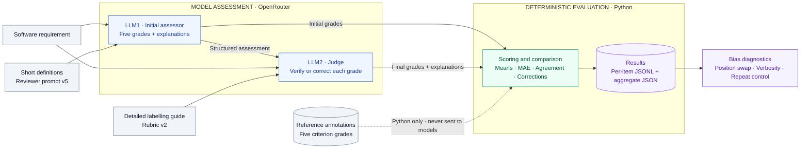

# Requirement Quality Grader

An evaluation harness for assessing software requirements on **atomicity,
testability, feasibility, clarity and completeness**. It measures whether a
second LLM assessment improves agreement with a reference set; improvement is
an empirical question, not an assumption.

The dataset contains **150 software requirements**: 20 development examples and
130 held-out test examples. The recorded experiments cover the 20 development
examples and six selected cases for each bias diagnostic.

## Architecture



LLM1 receives only the original requirement, a short system prompt and concise
criterion definitions. It does not receive the detailed guide. The judge checks
LLM1's proposals against the requirement and detailed guide. **Neither model
receives reference annotations, review status or Python comparison results.**

Both stages grade the **original requirement**. This measures final pipeline
agreement with requirement references; it does not separately validate a judge
that assigns an answer-quality score to LLM1's writing. The second assessor is
conditioned on LLM1's answer, and both stages use the same default model.

| Criterion | What it measures |
|---|---|
| `atomicity` | One independently deliverable obligation; conditions and fields do not automatically count as extra obligations. |
| `testability` | Objective verification without requiring a complete test procedure. |
| `feasibility` | Achievability under stated constraints; difficulty alone is not impossibility. |
| `clarity` | A reasonably unambiguous intended meaning. |
| `completeness` | Necessary information within the requirement's own scope. |

Grades are strict integers 0–5, higher is better. The overall score is the
unrounded sum divided by five, calculated in Python. Matching averages can hide
different criterion assessments, so evaluation also compares individual grades.
The active scheme is `grade_0_5_v2`; guide version is `requirement_quality_v2`.

## Setup

Python 3.11+ is intended; the recorded development environment uses Python 3.14.
Dependencies are pinned in `requirements.txt`. From a clean clone:

```bash
python3 -m venv .venv && .venv/bin/python -m pip install -r requirements.txt
```

Create `.env` locally if absent and set `OPENROUTER_API_KEY` there. Never commit
it or paste its contents into results. `.env.example` shows the variable names.
The default model is `openai/gpt-4o-mini` through OpenRouter, configurable through
`REVIEWER_MODEL`, `ASSESSOR_MODEL` or CLI flags. No Ollama service is required.

Offline checks require no API key:

```bash
.venv/bin/python -m unittest discover -s tests
.venv/bin/python -m harness.runner --split all --dry-run
```

## Run

```bash
.venv/bin/python -m harness.runner --split dev
```

The console prints each original requirement, LLM1 assessment, judge assessment
and average scores. Every selected item, including a failed request, gets a
JSONL row; partial successful output is preserved. Each run also gets a summary.
An interrupt saves the current partial item and ends the run.

Useful options:

```bash
.venv/bin/python -m harness.runner --split dev --limit 1 --output-dir results
.venv/bin/python -m harness.runner --data data/golden_set.jsonl --split all --dry-run
.venv/bin/python -m harness.runner --help
```

Model/prompt options are `--reviewer-model`, `--judge-model`,
`--reviewer-prompt`, and `--judge-prompt`. New paid model choices require a
verified pricing entry in `data/model_pricing.json`. Keep LLM1 prompt overrides
free of detailed guide content and references.

Results include reference provenance, both outputs and averages, correction
information, stage errors, tokens, latency, estimated cost, model identifiers,
configuration hashes, source-code hash, Git commit and worktree status. Files
use timestamp-and-random-suffix names and exclusive creation; they are not overwritten.
API responses are requested with a strict JSON schema and locally validated by
Pydantic. Failures are errors, never fabricated zero grades.

## Dataset and annotation workflow

`data/golden_set.jsonl` contains 150 unique requirements across software domains,
including authentication, APIs, payments, healthcare, privacy, accessibility,
performance and distributed systems. All grades 0–5 occur for each criterion,
but the distributions are deliberately not uniform. Most atomicity/feasibility
scores are high. See `results/dataset_validation_v2.json` for exact counts.

The original 20 texts remain dev. All 130 new texts are test; none were copied
into active prompts or guide examples. The references are **AI-prepared proposed
annotations**, not the old binary-to-score conversion. Historical datasets and
the previous guide live under `data/history/` and are rejected by the active loader.

A second rubric review is recorded in `data/annotation_review_ai.jsonl`, with
13 items flagged for reconsideration. Its suggestions do not alter the reference
snapshot used for the reported experiments.

A ready-to-edit CSV is provided at `data/reference_review.csv`. To export a fresh
copy (output must not already exist):

```bash
.venv/bin/python -m harness.review export --data data/golden_set.jsonl --csv /tmp/reference-review.csv
```

For each row, read the requirement and all five proposed grades and reasons
against `data/labelling_guide.md`. Edit the `*_grade` and `*_explanation` columns
as needed. Once reviewed, set `annotation_status` to `verified` and enter your
name in `reviewed_by`. Leave unfinished rows as `proposed`. Do not change IDs,
requirement texts, split, source hashes or column names.

Import into a **new** file:

```bash
.venv/bin/python -m harness.review import --data data/golden_set.jsonl --csv /tmp/reference-review.csv --output data/golden_set_reviewed.jsonl
.venv/bin/python -m harness.runner --data data/golden_set_reviewed.jsonl --split all --dry-run
```

Import recomputes averages, validates scores and provenance, records the initial
proposal and review history, and refuses a stale source or overwriting an output.
Partial review is supported. To continue later, export a new CSV from the latest
reviewed JSONL and use that same JSONL as the next import's source.
This follows the user's reported instructor clarification allowing one manually
verified reference set. No second-annotator agreement is claimed.

## Reliability and held-out evaluation

Every run separates dev/test and proposed/verified groups. Metrics include
per-criterion exact and within-one agreement, disagreement counts, MAE; overall
MAE, signed error, exact and within-0.2 agreement; all-five agreement; retained
and changed grades; corrections moving closer/farther/equal; and requirement-level
changes in overall error. Denominators and unavailable outputs are explicit.

Recalculate a summary offline:

```bash
.venv/bin/python -m harness.metrics results/YOUR_PIPELINE_RUN.jsonl --tolerance 0.2
```

A verified subset is reported separately from proposed references; it must not
be presented as complete final evaluation. After reviewing **all** test references
and finalizing development choices, freeze data, code, prompts, guide and models:

```bash
.venv/bin/python -m harness.runner --data data/golden_set_reviewed.jsonl --split all --dry-run --freeze
.venv/bin/python -m harness.runner --data data/golden_set_reviewed.jsonl --split test --frozen-config results/YOUR_FROZEN_CONFIG.json
```

`--split all` also supports complete dataset execution under the same test gate.
Test execution refuses unverified references or a missing/mismatched frozen
configuration. Do not tune prompts on test outputs. Freeze again only before the
first final evaluation or to document a new evaluation protocol explicitly.

## Bias experiments

Use saved **v5 development** results, reusing LLM1 outputs without new LLM1 calls:

```bash
.venv/bin/python -m harness.position_bias results/YOUR_PIPELINE_RUN.jsonl --limit 5
.venv/bin/python -m harness.verbosity_bias results/YOUR_PIPELINE_RUN.jsonl --limit 5
```

Position testing compares initial and corrected candidate assessments in both
A/B and B/A order. It maps choices back to candidate identities and reports
preference reversals, tie changes and first-position preference. This is a
separate pairwise diagnostic, not direct production-judge position bias.

Verbosity testing repeats each initial explanation verbatim three times without
changing grades or adding facts. It evaluates original, padded and repeated
original inputs, with alternating request order. The repeated original is a
control for ordinary model variability. Both experiments save exact inputs,
per-condition outputs, failures, usage and aggregate summaries. Small pilots
support debugging, not broad claims of absence of bias.

## Cost and reproducibility

`data/model_pricing.json` records the checked date and source of token rates.
`results/execution_plan_v5.json` documents the authorized execution plan.
Successful calls record actual token usage and a list-price cost estimate; any
provider-reported cost is also retained when available. Cache discounts can
make the list-price estimate conservative. Non-token account fees are excluded.

A local, ignored `.api-budget.json` ledger reserves a conservative cost bound
before each request and enforces a cumulative US$2 ceiling across commands.
SDK retries are disabled. Unknown-cost failures retain their reservation, even
across process restarts. Do not delete the ledger to bypass the cap. A future
budget increase needs a separately authorized code/configuration change.

Summaries report costs and latency by stage and project complete-run cost to
1,000 requirements (2,000 calls) and 100,000 requirements (100× volume). These
are linear workload estimates, not scaling measurements. Bias calls are separate.
Temperature 0 is not guaranteed deterministic; hashes identify actual inputs,
but provider changes and mutable model aliases can still affect reproducibility.

## Experimental results

The v5 development run completed **20/20 requirements without failures** using
`openai/gpt-4o-mini` at temperature 0. The comparisons below use the recorded
AI-prepared reference annotations; they measure reference agreement rather than
independent human agreement. Exact artifacts are indexed in [results/README.md](results/README.md).

| Metric | LLM1 | Judge |
|---|---:|---:|
| Criterion exact agreement | 48/100 (48%) | 50/100 (50%) |
| Criterion within-one agreement | 77/100 (77%) | 74/100 (74%) |
| Average criterion MAE | 0.83 | 0.85 |
| Overall-score MAE | 0.57 | 0.65 |
| Overall mean signed error | +0.19 | +0.07 |
| Exact overall agreement | 5/20 (25%) | 4/20 (20%) |
| Overall agreement within 0.2 | 7/20 (35%) | 6/20 (30%) |
| All five grades match | 4/20 (20%) | 4/20 (20%) |

| Criterion | LLM1 exact | Judge exact | LLM1 MAE | Judge MAE |
|---|---:|---:|---:|---:|
| Atomicity | 11/20 | 11/20 | 0.65 | 0.65 |
| Testability | 7/20 | 8/20 | 1.20 | 1.20 |
| Feasibility | 15/20 | 17/20 | 0.25 | 0.20 |
| Clarity | 7/20 | 7/20 | 1.15 | 1.15 |
| Completeness | 8/20 | 7/20 | 0.90 | 1.05 |

The judge retained 88/100 grades and changed 12/100. Of the changes, 5/12
(41.67%) moved closer to the proposals and 7/12 (58.33%) moved farther away.
Overall error improved on 1/20 requirements, worsened on 6/20 and was unchanged
on 13/20. The second stage did **not** improve overall MAE in this run.

### Bias diagnostics

| Experiment | Measured outcome | Sample |
|---|---|---|
| Position: candidate identity or tie changed | 0/6 (0%) | Six swapped candidate pairs |
| Position: strict preference reversal | 0/3 (0%) | Three pairs non-tied in both orders |
| First-position preference | 3/6 (50%) | Six non-tied judge calls |
| Verbosity: criterion grade changed | 0/30 (0%) | Five grades across six cases |
| Repeated-input control: grade changed | 0/30 (0%) | Same six cases |

### Runtime and cost

| Run | Calls | Tokens | Estimated cost (USD) |
|---|---:|---:|---:|
| Smoke | 2 | 3,136 | 0.00063465 |
| Development | 40 | 62,857 | 0.01277115 |
| Position diagnostic | 12 | 27,075 | 0.00435240 |
| Verbosity and controls | 18 | 45,070 | 0.00836610 |
| **Total** | **72** | **138,138** | **0.02612430** |

The dev pipeline averaged **6.40 seconds per requirement**. At the observed
workload and recorded token prices, 1,000 requirements would cost approximately
**$0.63856**, and 100,000 approximately **$63.85575**. These are linear projections,
not measured large-scale runs. Historical v2–v4 results use incompatible setups
and are not a controlled baseline for claiming a v5 prompt improvement.

## Limitations

| Limitation | Effect on interpretation |
|---|---|
| Dataset size and evaluation coverage | The corpus has 150 requirements; the recorded model evaluation covers 20 dev items, not the 130 held-out examples. |
| Subjective requirement assessment | Intermediate grades depend on engineering judgment and the interpretation of scope and severity. |
| Uneven grade distribution | Atomicity and feasibility are dominated by high scores; performance may differ on other distributions. |
| Same-model second assessment | The judge sees LLM1's answer and can inherit its assumptions; a second pass need not improve agreement. |
| Small bias samples | Six cases cannot establish that the model is generally free of position or verbosity sensitivity. |
| Provider variability | Temperature 0 and saved configuration hashes do not guarantee identical responses across provider updates. |

## Contributions

Git history records these contributions; this is not a claim that every activity
or team responsibility is captured by commits:

- **Asma Turki (`turkiasma`)**: rubric-based evaluation integration, runtime progress
  handling and v3 prompt refinements; directed the current completion work.
- **Emna Smaali**: v4 0–5 assessment architecture and OpenRouter integration.
- **Youssef Sassi (`SASSIX`)**: dataset scoring iterations and pipeline integration.

The PDF report is distributed separately. Saved experiment files and
`results/README.md` provide its evidence; `postmortem.md` records observed
implementation problems.
